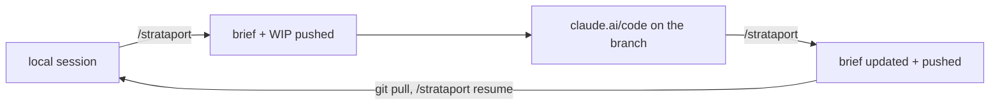

# strataport

`/strataport` — take this session's plan and context with you to Claude Code on the web.

```bash
claude plugin install strataport@adrianj98-skills
```

A web session starts with the repo at your branch and nothing else. Strataport writes what
it would be missing into `.claude/strataport/<branch>.md`. That covers the goal, the plan
with each step marked done or todo, the decisions and their reasons, what was ruled out, the
files and commands that matter, what isn't on the branch (env var names, local services) and
the next step. It then commits the work in progress with it and pushes. It checks that the
push landed and prints a prompt to paste into [claude.ai/code](https://claude.ai/code) on
that branch.



It never writes secrets into the brief. Files that look like secrets or local artifacts are
unstaged and listed in the brief instead. If you're on the default branch, it creates a
branch first.

| | |
|---|---|
| `/strataport` | package this session and push |
| `/strataport start with the tests` | same, with a note for the next session's first step |
| `/strataport resume` | read the brief for this branch, check it against the code, carry on |

The web side doesn't need the plugin. The pasted prompt is enough. Install it there too
if you want `/strataport` to hand the work back.

## Installing without the plugin system

```bash
curl -fsSL https://raw.githubusercontent.com/adrianj98/Skills/main/install.sh | bash -s -- strataport --global
```

See the [repo README](../../README.md#installing-without-the-plugin-system).
